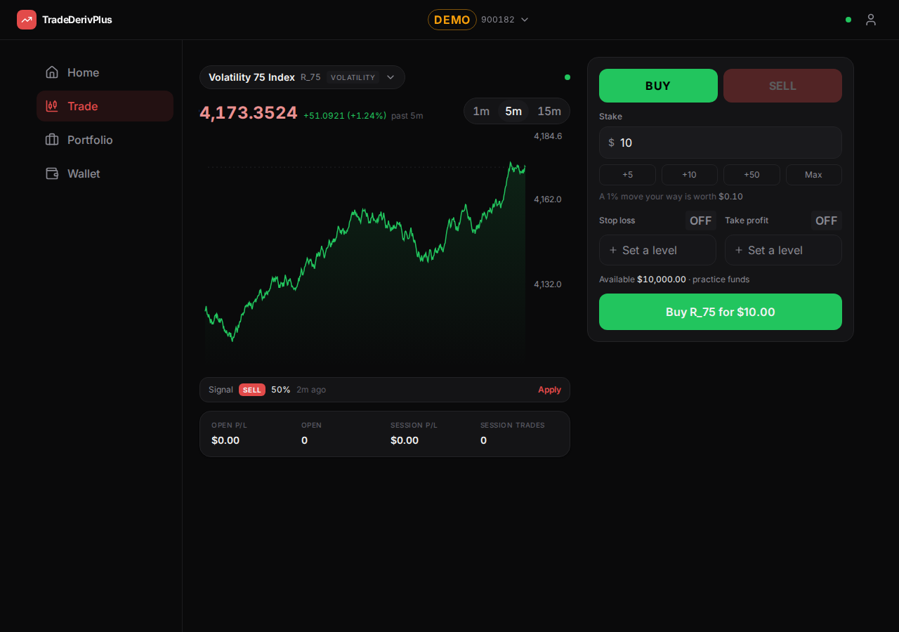
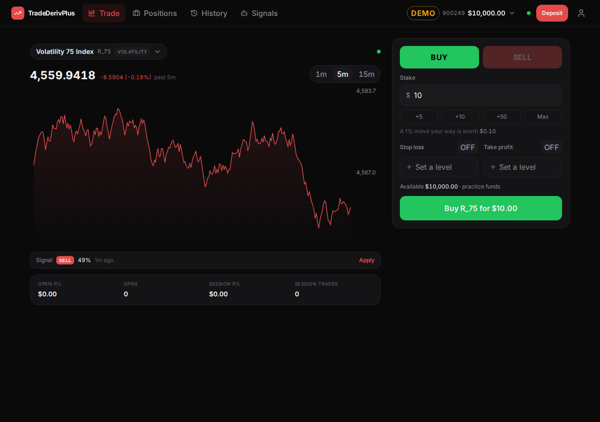
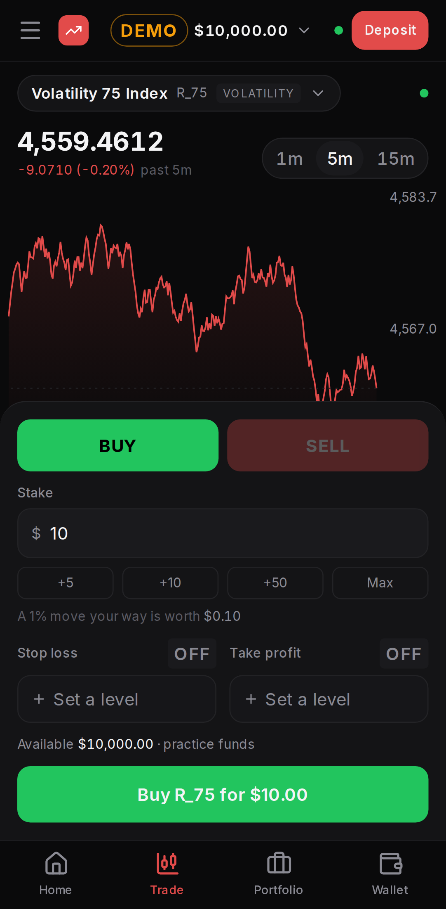
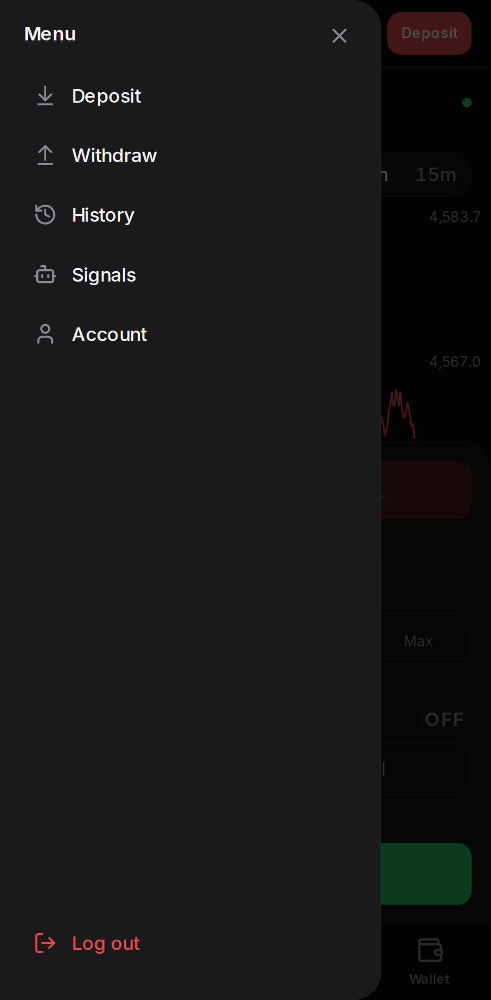

# TradeDerivPlus — One-Screen Migration, Phase 0 + Phase 1

**Scope:** Phases 0 and 1 of [`docs/investigation-reports/one-screen-migration-plan.md`](../investigation-reports/one-screen-migration-plan.md), which was itself scoped by [`docs/investigation-reports/nav-layout-investigation.md`](../investigation-reports/nav-layout-investigation.md).
**Date:** 22 September 2026
**Benchmark reference:** [`docs/reference/tnnbinary-mobile-menu.jpeg`](../reference/tnnbinary-mobile-menu.jpeg)
**Commits:** `0b20925`, `b89511c`, `d134456`, `36d605c` (Phase 0) · `4a179d5`, `62e56d8`, `0ec1056`, `37f1a31` (Phase 1)

---

## 1. Summary

The four structural problems that would have made the one-screen model misbehave are fixed, and the app now wears the shell it will keep.

Phase 0 was invisible by design. The price and signal sockets moved into the shell, so a screen can no longer close the market feed for the whole app by unmounting — the bug that would have fired on every overlay open once screens start layering. Query parameters merge instead of overwriting. The top bar's height is stated once and read by everything that pins itself below it. The two navigation landmarks have distinct names, and the end-to-end tests navigate through whichever one the viewport is actually showing.

Phase 1 replaced the chrome. The 220px desktop sidebar is gone and its destinations are in a horizontal top bar, named for what they are becoming: **Positions**, **History**, **Signals**. That alone gave the Trade screen's chart panel about **180px more width** — from roughly 420px to roughly 600px at a 1280px viewport — without touching the chart. The top bar now also carries the balance, a Deposit button, and the account switcher, so money is reachable from every screen rather than from Home and Wallet only. On a phone, a hamburger opens a left drawer with Deposit, Withdraw, History, Signals, Account and Log out. The bottom tab bar is untouched and still carries the four screens that still exist; it goes away in Phase 4, when there is one screen for it to be redundant against.

Deposit, Withdraw and the account switcher are now mounted once by the shell instead of once per screen. That is what lets the top bar and the drawer offer Deposit at all, and it is the mechanism every later phase will use to put Portfolio, Wallet and Signals on top of Trade.

| | |
|---|---|
| Before (Phase 0 end) |  |
| After (Phase 1 end) |  |

| Phone | Drawer |
|---|---|
|  |  |

**Nothing regressed visually, and nothing from Pass 1 was touched.** The chart, the order ticket and the session strip render exactly as they did; `SessionStrip` is still under the chart. The full end-to-end suite passes at both viewports.

---

## 2. Phase 0 — per-step outcome

### Step 1 — Shell-owned price and signal subscriptions

**Status: done.** Commit `0b20925`.

The old `usePriceStream` hook both *declared* which symbols a screen wanted and *owned* the socket that served them. Two screens mounting meant two sockets; one screen unmounting closed a socket the other still needed, and `socket.ts` announced `offline` on the way out, so the whole app showed a dead market while ticks were still arriving.

Those two jobs are now separate:

- `useWatchSymbols(symbols)` — what a screen calls. It adds the symbols to a **reference count** in the market store and drops them on unmount. Two screens wanting `R_75` must both let go before it stops streaming.
- `usePriceFeed()` / `useSignalFeed()` — called once, by `AppShell`, for the life of the session. They own the only sockets and subscribe to the merged watched set.
- `useSignalStream(handler)` is now purely a listener, so the shell's toast and any screen can both hear signals without either owning the connection.
- `socket.ts`'s `close()` no longer reports a status. A caller closing a socket knows why it did so; announcing `offline` from there made every intentional teardown look like a dead market. `usePriceFeed` sets the status on its own teardown instead.

`usePriceStream.ts` was renamed to `usePriceFeed.ts` rather than added alongside, so there is no second way to do this left in the tree.

**Guarded by a test, not just by inspection.** `user.trading.spec.ts` now walks Trade → Home → Portfolio → Home → Trade with a position open and asserts the ticket is still enabled and "Market feed offline" is absent. That sequence fails on the old code.

### Step 2 — Merge query parameters instead of replacing them

**Status: done.** Commit `b89511c`.

`TradeScreen` and `PortfolioScreen` both called `setSearchParams` with a fresh object, which silently deleted anything another feature had put on the URL. With overlays coming, several things will want a parameter at once.

New `lib/searchParams.ts` exports `mergeParams`, which takes an updates object where `null` means remove, and returns the updater `setSearchParams` expects. Four unit tests cover it.

One behaviour was deliberately kept and made explicit rather than incidental: choosing a new symbol still clears the signal prefill (`direction`, `sl`, `tp`, `expired`), because those levels belonged to the old symbol. Previously that happened as a side effect of wiping the URL; now it is four named deletions with a comment saying why.

### Step 3 — State the top bar's height once

**Status: done.** Commit `d134456`.

`spacing.topbar: '56px'` added to the Tailwind theme. `TopBar` renders `h-topbar`; Portfolio's sticky day headings use `top-topbar`; the Signals "new signals" pill uses `top-[calc(theme(spacing.topbar)+8px)]`, preserving its deliberate 8px of air. The hardcoded `top-14` and `top-16` are gone, so changing the bar's height is now one edit.

### Step 4 — Name the two navigation landmarks apart

**Status: done.** Commit `36d605c`.

Both bars were `aria-label="Main"`, and both are in the DOM at once. The bottom bar became `aria-label="Bottom"`, and the e2e specs gained a `goTo(page, destination)` helper that clicks through `nav:visible` — whichever bar the viewport is actually showing. That helper is what made Step 5 cheap: replacing the sidebar did not require rewriting any spec, only the helper.

### Phase 0 checkpoint

Screenshots at 1280px, 412px and 360px are pixel-comparable to the Pass 1 report. The connection dot stays green and the ticket stays enabled across Home → Trade → Portfolio → Home. Playwright passed at both viewports.

---

## 3. Phase 1 — per-step outcome

### Step 5 — The desktop top bar, and the end of the sidebar

**Status: done.** Commit `4a179d5`.

The row, left to right: logo (links to Home, and will link to the main surface), **Trade · Positions · History · Signals**, then the account pill with the balance on it, the connection dot, a **Deposit** button, and the profile icon.

- **Naming.** The nav says Positions and History, not Portfolio and Wallet, because those are the panels the app is becoming. The screens behind them are unchanged for now.
- **Trade is temporary.** It is in the row only until Trade becomes the surface everything else sits on, at which point the logo is the way back and the entry goes away. There is deliberately no Home entry — the logo is already that.
- **Styled as frame, not as triggers.** The items are text-and-icon links with the same subtle active treatment the sidebar used, because Positions is on its way to being a normally-open panel rather than a modal.
- **The sidebar went in the same commit.** A sidebar and a top-bar nav on screen together is worse to review than either alone, and the width gain is the point of the step.

### Step 6 — The phone's top bar

**Status: done.** Commit `62e56d8`.

Same component, different arrangement below `lg`: hamburger, logo mark, the account pill centred with the type badge and balance only, then the dot and Deposit. The account number is dropped — it does not fit beside a balance on a phone, the balance is what a trader is checking, and the number is still in the switcher and on Profile.

The Deposit label's breakpoint was **measured rather than guessed**. Hiding it below `sm` (640px) meant every phone got a bare icon, when the space is only contested at the narrow end. With a five-figure balance in the pill, the word fits from 400px up, so the threshold is `min-[400px]`; only a 360px screen falls back to the icon. The button's accessible name is "Deposit" at every width.

### Step 7 — The navigation drawer

**Status: done.** Commit `0ec1056`.

A left-anchored drawer with Deposit, Withdraw, History, Signals, Account, and Log out pinned at the foot. Deposit and Withdraw raise the shell's sheets rather than navigating, so the drawer closes into the flow instead of into a screen; the destinations close it on click.

The shared `Sheet` grew a `side` prop rather than spawning a second component, so the drawer inherits the same overlay, focus trap, escape handling and close button as every other sheet. A `slide-in-left` keyframe sits beside the `slide-up` one already in the config. No Live Chat entry and no support contacts — both confirmed out of scope.

### Step 8 — Mount the money sheets once

**Status: done.** Commit `37f1a31`.

`DepositSheet`, `WithdrawSheet` and `AccountSwitcher` were each mounted by more than one screen, so the same sheet existed several times over and only opened from the screen that owned it. `AppShell` mounts each once now, behind a small `overlays` store that follows the existing `toast` pattern: a module-level `overlay.deposit()` API any component can call, a single mount in the shell, and one overlay open at a time — so opening Deposit from the drawer puts the drawer away rather than stacking two sheets.

Home and Wallet lost their copies and their local open/close state; their buttons now call the shell's openers. The deposit e2e spec exercises this path unchanged, which is the useful part: the flow is identical from the user's side.

---

## 4. Deviations and judgement calls

**Steps 5 and 6 are one component, so the commits split differently than the prompt implies.** The desktop and mobile top bars are two arrangements of one file; writing "the desktop one" necessarily wrote the mobile one. Commit `4a179d5` is therefore the whole bar plus the sidebar removal, and `62e56d8` is the mobile-specific refinement that measurement produced. Eight steps still map to eight commits.

**Step 5's commit contains some of Step 8's substance, on purpose.** The new Deposit button had to work in the commit that introduced it, which meant the shell had to own a deposit sheet at that point. So `4a179d5` adds the overlay store and the shell's mounts, and `37f1a31` removes the now-duplicate mounts from Home and Wallet. Between those commits both existed, which is harmless — a closed Radix dialog renders nothing — and the end state is exactly what the plan asked for.

**For one commit, the hamburger opened nothing.** Between `62e56d8` and `0ec1056` the button existed and the drawer did not. The alternative was a drawer with no way to open it. Nothing was unreachable in either case, since the bottom bar was untouched throughout.

**The e2e helper translates destination names per breakpoint.** The two bars no longer agree: the top bar says Positions and History, the bottom bar still says Portfolio and Wallet, and Home has no top-bar entry. `goTo` maps the names and clicks the logo for Home on wide viewports. The specs still read in the app's current vocabulary, and the mapping table is the one place that knows about the transition.

**One lint warning above the pre-existing baseline**, carried from Phase 0: `usePriceFeed.ts` trips the React Compiler's "cannot access refs during render" rule with the same ref-holding-a-socket pattern already accepted in `useAccountStream.ts` and `DepositSheet`. Total is 21 warnings against a baseline of 20. Changing the pattern in one hook and not the other two would be worse than the warning.

---

## 5. Verification

`npm run typecheck`, `npm test` and `npm run build` were run after every step; all clean at every commit. Playwright was run after each phase.

| | Phase 0 end | Phase 1 end |
|---|---|---|
| Typecheck | clean | clean |
| Unit tests | 67 passed (63 + 4 new) | 67 passed |
| Build | clean | clean |
| Lint | 21 warnings (baseline 20) | 21 warnings |
| Playwright | 11 passed, 1 skipped | 11 passed, 1 skipped |

**A note for whoever runs the suite next.** Two admin specs failed on the first Phase 1 run with "Too many requests", and the failures moved between tests on re-runs. This is not the app: the local API was running production auth limits (`AUTH_RATE_EVERY=3s`, burst 10, and a quarter of that rate for admin login), and a suite that registers and logs in a dozen times empties that bucket. CI already sets `AUTH_RATE_EVERY=200ms` and `AUTH_RATE_BURST=25` for exactly this reason (`.github/workflows/ci.yml:163`). Restarting the API with those values produced a clean run — and cut the suite from three minutes to seventy seconds, because the failures were 60-second timeouts. Local e2e runs should use the CI values.

Screenshots in this report come from a live, ticking mock feed, captured by `web/e2e/shots.mjs`, which registers a fresh user per viewport.

---

## 6. What Phase 2 inherits

**Deliberate, temporary overlaps.** These are consequences of adding the target chrome before dissolving the screens beneath it, and each resolves in a later phase:

- The balance appears twice on Home — in the top-bar pill and in the balance card. Phase 4 dissolves Home.
- Wallet is reachable as "History" in the top bar and "Wallet" in the bottom bar; Portfolio likewise as "Positions" and "Portfolio". Phase 4 removes the bottom bar.
- Deposit appears in the top bar, in the drawer, and as in-page buttons on Home and Wallet. The in-page buttons go when those screens do; all three already call the same sheet.

**Untouched and ready.** The main surface is still capped at `max-w-[1200px]` and the desktop Positions panel does not exist yet — both are Phase 2, both confirmed. `SessionStrip` stays under the chart. The notification bell, Live Chat, contract-type tabs, the digit row, AUTO/MANUAL and any bot or AI nav item remain out of scope.

**Risk to Pass 1 work: none observed.** No file from the Pass 1 rendering work was modified except `TradeScreen`'s symbol handler and two sticky offsets. The chart, ticket and session strip are byte-identical, and the screenshots above confirm they render as Pass 1 left them — with more room.
