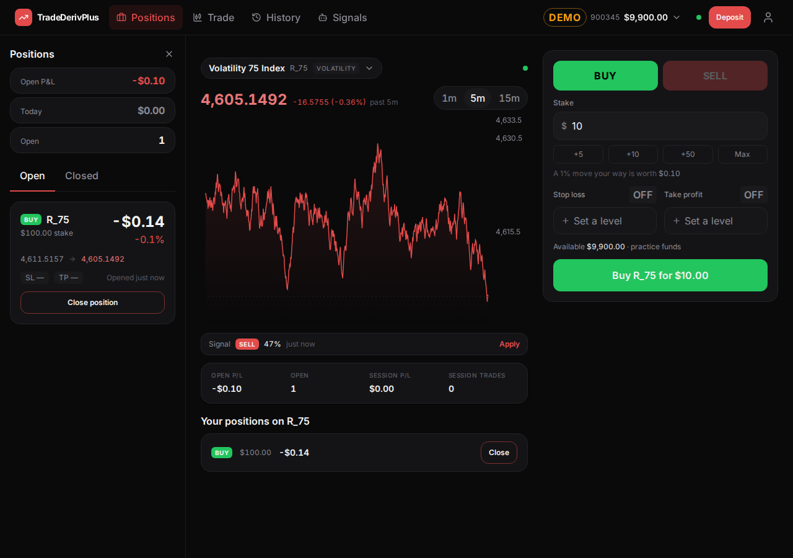
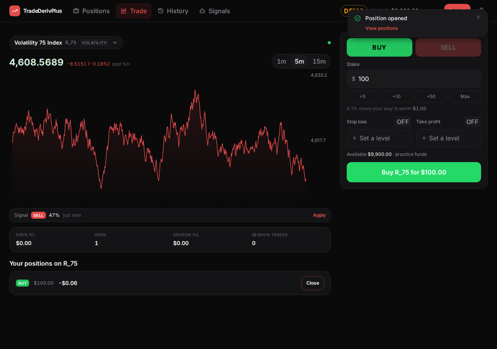
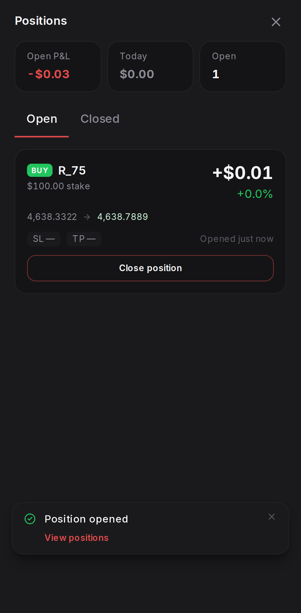
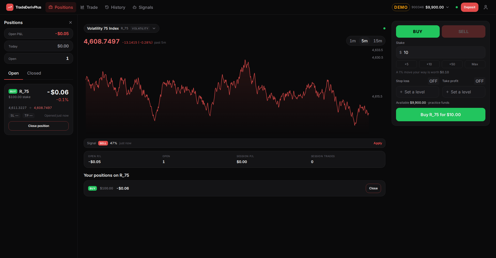

# TradeDerivPlus — One-Screen Migration, Phase 2

**Scope:** Phase 2 of [`docs/investigation-reports/one-screen-migration-plan.md`](../investigation-reports/one-screen-migration-plan.md) — the panel primitive, the `?panel=` URL scheme, the desktop layout change, and Portfolio migrated into a Positions panel. Builds on [Phase 0 + 1](./one-screen-migration-phase-0-1.md).
**Date:** 22 September 2026
**Commits:** `5f6a091`, `bcb77d2`, `19fcc2b`, `70159f0`, `8bb5d43`, `3724f10`

---

## 1. Summary

**Positions is no longer a screen you travel to. It is a panel that opens beside the chart, and the chart keeps ticking underneath it.**

On a desktop it is a column on the left, open by default on a fresh session the way the benchmark's is, dismissible from the top bar or its own close button. On a phone there is no room to sit beside anything, so it is a full-screen sheet that the bottom bar, the drawer and the position toast all open. Which panel is open lives on the URL, so the back button closes it, a link can open it, and the old `/portfolio?tab=closed` still lands exactly where it used to — on the closed trades, now with the market visible behind them.

The desktop main surface also stopped being capped at 1200px. That was necessary rather than cosmetic: inside the old cap, adding a 300px column would have made the chart *narrower than it was before this migration started*, undoing what Pass 1 bought.

| | |
|---|---|
| Desktop, panel open |  |
| Desktop, panel closed |  |

| Phone | 1920px |
|---|---|
|  |  |

**The one number worth arguing about.** With the panel open, the chart measures 528px at 1280px of viewport, 688px at 1440px, and 1168px at 1920px. The plan predicted about 760px at 1440px; it was optimistic by roughly 70px because it did not count the page's own padding and the grid gap. More importantly, **on a 1280px laptop an open panel costs exactly what Phase 1's sidebar removal gained** — 748px becomes 528px, which is the width the chart had before any of this started. From about 1500px up the panel is free. Section 5 sets out the options; none of them are urgent, because the panel is dismissible and its state is remembered in the URL.

Nothing else moved. Wallet, Signals, Profile and Home are still routes, still reachable, still capped at their old reading width, and still look exactly as they did.

---

## 2. Per-step outcome

### Step 1 — The panel primitive

**Status: done.** Commit `5f6a091`.

`Sheet`'s `side` prop already existed from Phase 1, and it covers the phone case with one addition: `side="panel"`, which fills the screen and — unlike a bottom sheet — never becomes a centred 440px dialog at `sm`, because by the width where that would apply a panel is on its way to being a column.

The desktop case is a new `ui/Panel` component that renders **plain markup, not a Radix dialog**. The prompt asked whether a `variant` distinction was right; it is, and the distinction is deeper than styling, so it is expressed as different components rather than different classes:

- The desktop panel is an `<aside>` with a header and a scroll area. No portal, no backdrop, no focus trap, no scroll lock, no dismiss layer.
- The phone panel is a `Sheet`, which is all of those things.

**A Radix dialog with `modal={false}` was considered and rejected.** It still moves focus into itself on open and still registers as a dismissable layer, and neither is wanted for a column that is simply part of the page — the user is meant to read positions *while* the chart runs and the ticket stays usable, so nothing may take the keyboard or the pointer away from them.

Which of the two renders is decided in JavaScript, by a new `useIsDesktop` hook reading Tailwind's `lg` breakpoint through `matchMedia` and `useSyncExternalStore`. Responsive behaviour belongs in CSS and nearly all of the app's still is; this is the exception where the two breakpoints need different markup and different interaction, not different widths.

### Step 2 — The `?panel=` URL scheme

**Status: done.** Commit `bcb77d2`.

`usePanel()` reads and writes `panel` through Phase 1's `mergeParams`, so it composes with `?symbol=` and `?tab=` instead of competing with them. The resolver is a pure function with its own unit tests; the hook is the thin part around it.

**The decision the prompt asked for: the desktop default is implicit — no parameter means the panel is open.** The alternative, writing `?panel=positions` on mount, does not survive contact with the close button: once the parameter is absent again, the mount effect cannot tell "fresh load" from "the user just closed it", and re-adds it. That is a loop, and avoiding it requires a sentinel anyway. So the sentinel is the whole mechanism instead of a patch on top of one:

| URL | Desktop | Phone |
|---|---|---|
| `/trade` | Positions open | closed |
| `/trade?panel=positions` | open | open |
| `/trade?panel=none` | closed | closed |

A fresh desktop session therefore shows the panel with no query string to say so, and a phone URL copied to a desktop still opens what it names. An unrecognised value falls back to the default rather than to an empty column, which is what makes a Phase 3 link (`?panel=history`) degrade gracefully today.

Opening and closing **push** history entries rather than replacing them, which is what makes the back button close a panel instead of leaving the app. `?tab=` still replaces, as it did before, so flipping between Open and Closed does not fill the back stack.

### Step 3 — Uncapping the desktop surface

**Status: done.** Commit `19fcc2b`.

The `max-w-[1200px]` cap moved off the shell's layout row and onto the `<main>` element, applied only when the current route is *not* the main surface. One line, one place, and it disappears in Phase 4 when there are no other routes.

This is what keeps "nothing else changes" true: Home, Wallet, Signals and Profile still sit in the same 1200px reading width on any monitor, because they were laid out for it. Only the trading surface uses the whole window.

Panels and sheets keep their own widths — the panel is 300px, sheets are unchanged at 440px on desktop.

### Step 4 — Portfolio into the panel

**Status: done.** Commit `70159f0`.

`PortfolioScreen.tsx` became `PositionsPanel.tsx` (moved with `git mv`, so the diff reads as a move). The content is the same: three summary figures, Open and Closed tabs, `PositionCard`, `ClosedTradeRow`, the day groupings, the close confirmation, and `?tab=` behaviour.

What changed is what surrounds it:

- **It supplies no title and no padding.** The panel owns both, and owns them differently at each width — 16px in a desktop column, the sheet's 20px on a phone. `PageHeader` is gone from it, since the panel's header row is its title.
- **Sticky day headings moved from `top-topbar` to `top-0`**, which is breakage #3 from the plan landing where it was expected to: the panel scrolls its own container, so "56px from the top of the window" was the wrong anchor.
- **The three summary figures stack in the desktop column.** Side by side they need about 85px each, which truncates a five-figure P&L. On a phone, where the panel is the whole screen, they stay in a row exactly as before.
- **The empty state's "Go to Trade" became "Close"** — plan breakage #12. Trade is behind the panel, not somewhere to go.

Navigation was wired in the same commit, because a panel nothing can open is not reviewable:

- **The top bar's Positions item is a `<button aria-pressed>`, not a link.** It toggles a column that coexists with the chart, which is not what a link means, and `aria-pressed` is the same treatment Pass 1 gave the chart's range control.
- **Trade stops highlighting while a panel is open.** Two lit items read as two places to be.
- The bottom bar's Portfolio tab became **Positions**, pointing at the surface with the panel open and highlighting on the panel rather than on the path. The drawer gained the same entry.

### Step 5 — The old route

**Status: done.** Commit `8bb5d43`.

`/portfolio` renders a `PanelRedirect`, which carries named parameters across and drops the rest: `/portfolio?tab=closed` → `/trade?panel=positions&tab=closed`, replacing the history entry so back does not bounce. It is written generically (`carry={['tab']}`) because Phase 3 adds three more of these.

Covered by a test, not by inspection — see section 6.

### Step 6 — Inbound references

**Status: done.** Commit `3724f10`.

The position toast's action was `navigate('/portfolio')`; it now opens the panel and is relabelled **"View positions"**, since "View in Portfolio" named a screen that no longer exists. The empty-state link was dealt with in Step 4, where the file moved.

### Step 7 — The account-error banner

**Status: done, with no code.** Verified rather than changed.

The banner already sits between the top bar and the layout row, which makes it full-width above both the panel and the main column — the prompt's default, and the right one: the thing that failed is the account, which both columns depend on. Confirmed by forcing the accounts request to fail with the panel open at 1280px and at 390px. Nothing about the three-column layout conflicts with it.

### Step 8 — The concurrency check

**Status: done.** Covered in sections 4 and 6.

---

## 3. Files changed

| File | What |
|---|---|
| `components/ui/Panel.tsx` | **New.** The desktop column and the choice between it and a sheet |
| `components/ui/Sheet.tsx` | `side="panel"`; a `closeLabel` prop so a close button can name what it closes |
| `hooks/useIsDesktop.ts` | **New.** The `lg` breakpoint, in JavaScript |
| `features/shell/usePanel.ts` | **New.** The `?panel=` scheme, and `MAIN_SURFACE` |
| `features/shell/usePanel.test.ts` | **New.** Six cases over the resolver |
| `features/shell/redirects.tsx` | **New.** `PanelRedirect`, reusable for Phase 3's three |
| `features/shell/AppShell.tsx` | Mounts the panel; uncaps the main surface |
| `features/shell/TopBar.tsx` | Positions as a toggle; Trade unlit while a panel is open |
| `features/shell/TabBar.tsx` | Positions tab; active state from the panel, not the path |
| `features/shell/NavDrawer.tsx` | Positions entry |
| `features/portfolio/PositionsPanel.tsx` | Renamed from `PortfolioScreen.tsx`; padding, title and sticky offsets handed to the panel |
| `features/trading/TradeScreen.tsx` | The toast opens the panel |
| `App.tsx` | `/portfolio` is a redirect |
| `e2e/user.panels.spec.ts` | **New.** Three specs — URL round trip, feed under load, nested overlay |
| `e2e/helpers.ts` | `positionsPanel`, `openPositions`, `closePositions` |
| `e2e/user.trading.spec.ts` | Reaches positions through the panel |
| `e2e/measure.mjs` | **New.** Chart width measurement, not a test |

---

## 4. The nested-overlay verification

The plan flagged this (breakage #19) as the app's first dialog-inside-a-dialog. The finding is that **half of it does not exist, and the half that does behaves correctly.**

**On desktop there is no nesting at all, by design.** The panel is not a dialog, so the close confirmation is an ordinary modal over an ordinary page — the same situation as every other sheet in the app. This is a direct consequence of the Step 1 decision, and it is worth stating because it means Phase 3's `TransactionDetail`-inside-History has no desktop nesting problem either.

**On a phone it is genuinely a dialog over a dialog**, and it was checked rather than assumed:

| Question | Answer |
|---|---|
| Stacking | The confirmation renders above the panel. Both are portalled to `body`, in open order |
| Escape, once | Closes the confirmation only. The panel stays open, on the same tab |
| Escape, twice | Closes the panel. The phone's panel is a modal and that is what modals do; the desktop's stays, because it is part of the page. Both are asserted, per breakpoint |
| Focus | Radix moves focus into the confirmation and returns it to the panel on dismiss. Opening the panel by tapping shows no focus ring; opening it from a URL does, which is the browser's `:focus-visible` heuristic doing its job |
| Inertness | While the confirmation is open, Radix marks the app `aria-hidden` and sets `pointer-events: none` on the body, so the panel underneath is properly inert |

That last row had a consequence worth carrying into Phase 3: **while a phone panel is open, the rest of the app is `aria-hidden`,** so nothing behind it can be found by role — not by a screen reader, and not by a test. The first version of the trading spec failed on exactly this, trying to click the bottom bar with the panel still open. Any flow that continues after using a panel has to close it first, which is also what a person would do.

---

## 5. Discovered mid-implementation

**1. The plan's chart-width arithmetic was optimistic, and the 1280px case is a real trade-off.** Section 2.4 predicted ~760px at 1440px; the measured figure is 688px, because the estimate omitted the surface's 48px of horizontal padding and the 24px grid gap. The consequence that matters is at the low end: at 1280px an open panel puts the chart back to 528px, which is precisely its pre-migration width — the panel costs what Phase 1's sidebar removal gained. The options, in order of cost: leave it (the panel is dismissible, and closing restores 828px); narrow the panel below `xl` (about 40px back, and the position cards get tight); or revisit the ticket's fixed 380px column on narrow desktops, which is Pass 1 work and was deliberately not touched here. **Recommendation: leave it, and revisit the ticket width in Phase 5 if anyone reports it.**

**2. Full width on a very large monitor produces a very wide chart.** At 2560px the chart measures 1808px against a fixed 340px height — about 5:1. It is not broken and it is what "full width" was asked for, but it is the layout problem worth flagging back. Two cheap answers exist: a taller chart above `2xl`, or a cap around 1800px. Both touch Pass 1's chart sizing, which is out of scope here, so neither was applied.

**3. The same position is now visible three times at once on desktop** — in the panel, in "Your positions on R_75" under the chart, and counted in `SessionStrip`. The plan predicted this and asked for a look after Phase 2 rather than a decision before it. It is now observable in the screenshots above, and the inline block is the weakest of the three.

**4. "Close Positions" answered to a search for "Close position".** Accessible-name matching is substring-based, so the panel's own close button was indistinguishable from a position card's. That produced a genuinely confusing test failure — the harness clicked the panel shut and then waited for a button inside it. Fixed on the app's side rather than only in the test: `Sheet` gained a `closeLabel`, so both the phone sheet and the desktop column say "Close Positions". That is better for a screen reader too.

**5. A toggle plus a one-shot "is it open?" check is a race.** The test helper probed visibility immediately after a route change, decided the panel was closed, and clicked a toggle that then shut a panel which had just opened. The helper now retries the whole open-and-check until the panel is actually there. Worth knowing before Phase 3 writes three more of these.

**6. `Panel` does not expose its scroll container, and Phase 3 needs it.** Breakage #5 — the Signals screen's "N new signals" pill listens on `window.scrollY`, which does not move inside a panel. Binding it to the panel's scroll area needs a ref out of `Panel`, which is a small API addition rather than a surprise, but it is a prerequisite for the Signals panel and not something Phase 2 needed.

**7. Minor: the desktop panel's height does not account for the account-error banner.** It is `100vh` minus the top bar, so while that banner is showing, the bottom ~28px of the panel sits below the fold until the page is scrolled. Only reachable in an error state, and it corrects itself on the first scroll.

---

## 6. Verification performed

`npm run typecheck`, `npm test` and `npm run build` after every step, all clean. Lint holds at 21 warnings — the same 20-warning baseline plus the one `usePriceFeed` warning documented in Phase 0. No new ones.

| | Result |
|---|---|
| Unit tests | 73 passed (67 + 6 new resolver cases) |
| Playwright | 17 passed, 1 skipped, both the `mobile` and `desktop` projects |
| Lint | 21 warnings, unchanged |

**The concurrent-load checks the phase exists for:**

- **Panel and chart together.** With the panel open and a position running, the card's live profit and loss is asserted to render as a signed figure — so the panel is *being fed*, not merely open, while the chart draws the same symbol. This is `useWatchSymbols` serving two consumers of one symbol for the first time.
- **Opening and closing the panel repeatedly.** Three full cycles at both breakpoints, then the order ticket is asserted still enabled and "Market feed offline" asserted absent. On a phone each cycle mounts and unmounts the panel's whole subtree, which is exactly the unmount that used to close the socket for everyone. It does not.
- **The URL round trip.** `/portfolio?tab=closed` redirects, arrives with the Closed tab selected, closes, reopens through the UI, and the back button closes it again.

**Measured chart widths** (`node e2e/measure.mjs`, Chromium, the real app against a live feed):

| Viewport | Before this phase | Panel open | Panel closed |
|---|---|---|---|
| 1280px | 748px | **528px** | 828px |
| 1440px | 748px | **688px** | 988px |
| 1920px | 748px | **1168px** | 1468px |
| 2560px | 748px | **1808px** | 2108px |

"Before this phase" is Phase 1's figure, capped at 1200px and identical at every viewport above it. The pre-migration figure, with the sidebar and the cap, was about 528px.

Also checked by hand, from the screenshots in section 1: Home, Wallet, Signals and Profile are unchanged at 1280px and still capped at 1920px; the account-error banner spans the full width above the panel; the phone panel opens without a focus ring when tapped.

---

## 7. Readiness for Phase 3

**Ready.** Phase 3 is three repetitions of what this phase settled, and the pattern is in place: a panel name added to `PANELS`, a `Panel` in the shell, a `PanelRedirect` for the old route, and a screen that gives up its padding and its `PageHeader`.

Three things to carry in rather than discover:

1. **The Signals panel needs a scroll container from `Panel`** (finding 6). It is the only one of the three with a real code change beyond the move, and it is the first thing to build in that phase rather than the last.
2. **A phone panel holds the app behind it `aria-hidden`** (section 4). The History panel opens `TransactionDetail` from inside itself, which is the same shape as the case verified here, so it should behave — but any test that continues after opening a panel must close it.
3. **`PageHeader` will have no consumers left** once Wallet, Signals and Profile migrate, which is the Phase 5 decision the plan anticipated. Worth noticing when the last one goes rather than sweeping for it later.

Nothing found in this phase should be resolved before Phase 3 starts. The two open items — the 1280px chart width and the ultrawide aspect ratio — are both layout judgements for the client, not blockers, and both are cheaper to settle once all four panels exist and the bottom bar is gone.
