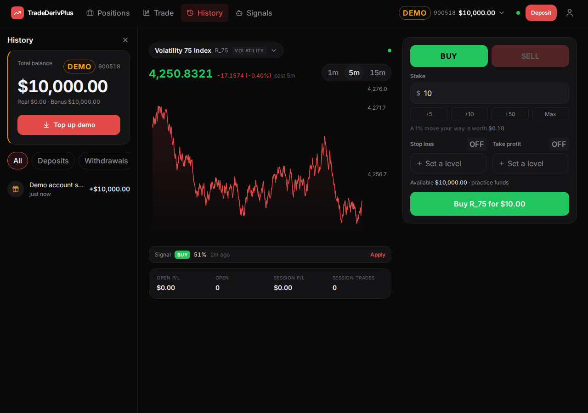
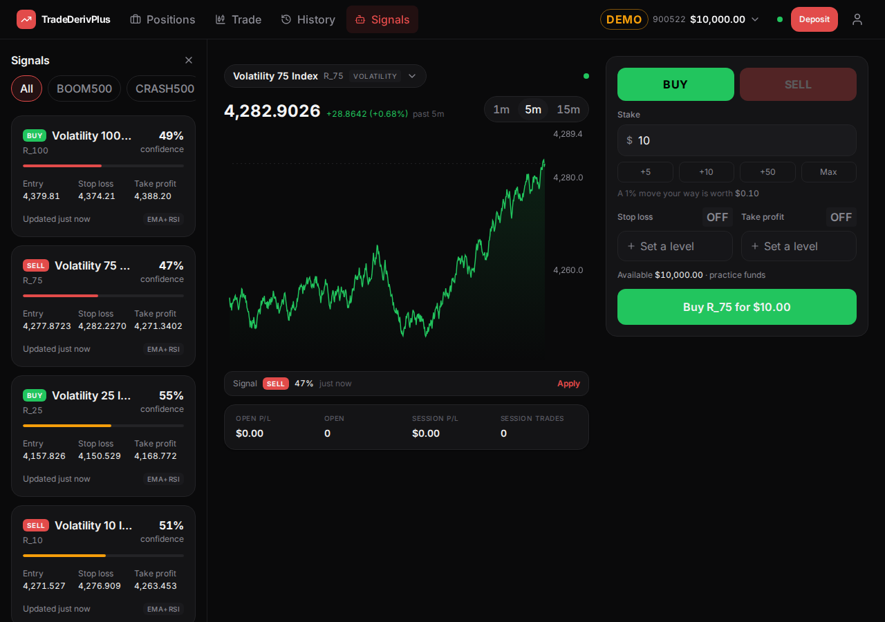
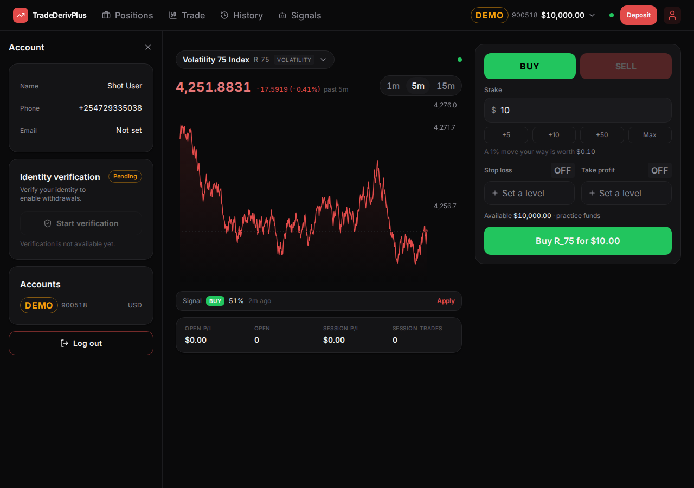
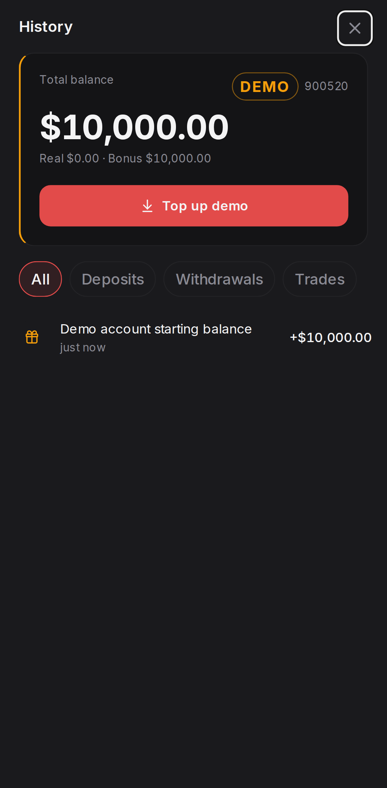
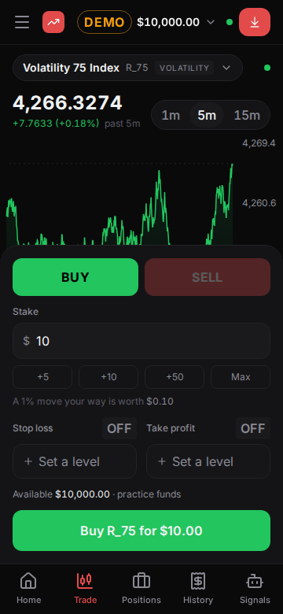
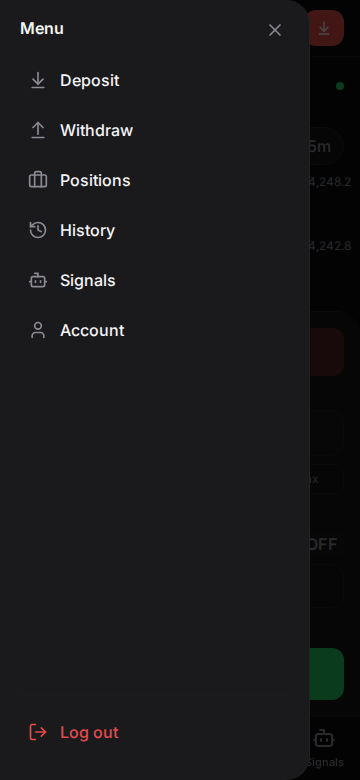

# TradeDerivPlus — One-Screen Migration, Phase 3

**Scope:** Phase 3 of [`docs/investigation-reports/one-screen-migration-plan.md`](../investigation-reports/one-screen-migration-plan.md) — Wallet, Signals and Profile migrated into the History, Signals and Account panels. Builds on [Phase 0 + 1](./one-screen-migration-phase-0-1.md) and [Phase 2](./one-screen-migration-phase-2.md).
**Date:** 22 September 2026
**Commits:** `0f960a4`, `984624b`, `d07e046`, `373317b`, `c6af7c5`

---

## 1. Summary

**Three more screens became panels, and the trading surface is now the only place the app goes.** History (was Wallet), Signals and Account (was Profile) open beside the chart on a desktop and as full-screen sheets on a phone, exactly as Positions has since Phase 2. `/wallet`, `/signals` and `/profile` still work — they redirect to the panel that replaced them.

What the client will notice:

- **The top bar is now four toggles and one link.** Positions, History and Signals say pressed rather than lighting up like a destination, and the profile icon at the far right opens the Account panel instead of navigating away. Trade is the only remaining link.
- **Closing a panel returns to the default rather than to nothing.** On a desktop, closing History puts Positions back, because Positions is what an empty URL means there. Closing Positions still empties the column, since it is the thing being dismissed.
- **The phone's bottom bar now has five tabs** — Home, Trade, Positions, History, Signals — and Account moved to the drawer, which is where it already was.
- **Everything else is where it was.** The content of all three moved essentially unchanged: the balance card and the four filter chips, the symbol chips and signal cards, the identity rows and the KYC card in its current unavailable state.

| Desktop — History | Desktop — Signals | Desktop — Account |
|---|---|---|
|  |  |  |

| Phone — History | Phone — five tabs | Phone — drawer |
|---|---|---|
|  |  |  |

**One thing found that is worth reading even if nothing else here is.** Verifying focus return for the transaction detail — the check the prompt asked for — turned up an app-wide defect that has nothing to do with panels: **closing any sheet in this app dropped keyboard focus onto the page body.** Radix returns focus to a `Dialog.Trigger`, and every sheet here is opened from code rather than from a trigger, so there was nothing to return it to. Section 4 has the detail; it is fixed in `Sheet`, so deposit, withdraw, the account switcher, the symbol picker and the close-position confirmation all benefit.

---

## 2. Per-step outcome

### Step 1 — The scroll container (prerequisite, built first)

**Status: done.** Commit `0f960a4`.

`Panel` publishes the element it scrolls inside on a context, and `Sheet` takes a `bodyRef` so the phone form can publish the same thing. Consumers read it with `usePanelScroll()`.

Three decisions inside a small change:

- **A context rather than a render prop**, because the consumer is the panel's content, not the shell that mounts it — the shell would otherwise have to thread a ref through every panel just so one of them can use it.
- **State, not a ref.** The consumer reads this during render to set up an effect, and a ref mutated in a callback would not trigger the render where it becomes non-null. So `Panel` holds the node in `useState` and attaches it with a callback ref.
- **The context and hook live in their own file** (`ui/panelScroll.ts`) rather than beside the component, which keeps `Panel.tsx` a components-only module and the lint count at its baseline.

### Step 2 — History panel (Wallet)

**Status: done.** Commit `984624b`.

`WalletScreen.tsx` became `HistoryPanel.tsx` with `git mv`. Content unchanged: `BalanceCard`, the four filter chips, the transaction list with pending deposits pinned, and the `TransactionDetail` sheet. What changed is the frame:

- `PageHeader` removed; the panel's header row is the title.
- The page gutters (`px-gutter lg:px-6`) removed, since the panel supplies padding — 16px in a desktop column, the sheet's 20px on a phone.
- The transaction list cancels that padding with a negative margin, so rows stay edge to edge: a row's hover and a pending deposit's amber left edge both want the full width.
- The list's desktop-only card treatment (`lg:mx-6 lg:rounded-card lg:border`) went away. It existed to inset a list from a 1200px page; inside a 300px panel that is a bordered box inside a bordered box.

**The filter stays local `useState`, deliberately.** The prompt asked for the decision explicitly. Positions' `?tab=` is on the URL because something links to it — the old `/portfolio?tab=closed` deep link, which had to survive the move. Nothing links to a filtered history, and no requirement produced one. Putting it on the URL would add a parameter that only ever gets written, plus another `mergeParams` interaction to reason about, and would leave `?filter=deposits` in a link somebody shares for reasons they did not intend. It can move later in one small change if a use for it appears.

`/wallet` redirects through the Phase 2 `PanelRedirect` with nothing to carry.

### Step 3 — Signals panel

**Status: done.** Commit `d07e046`.

`SignalsScreen.tsx` became `SignalsPanel.tsx`. Content unchanged apart from what a 300px column forces:

- **The pill binds to the panel** (section 5), and its sticky offset moved from `top-[topbar+8px]` to `top-2`, because it now sticks to the top of the panel rather than clearing a top bar that is no longer above it.
- **The two-column card grid became one column.** `lg:grid-cols-2` in a 300px panel is two 130px cards.
- The gutters and `PageHeader` went, as in Step 2.

`/signals` redirects. The inbound link the prompt asked about does exist: Home's "Latest signal" card has a **See all**, and it now opens the panel (Step 4).

**One behaviour worth naming.** Clicking a signal card still goes to `/trade?symbol=…&direction=…&sl=…&tp=…` and applies it to the ticket, which is unchanged — but that URL carries no `panel`, so arriving there means the default state: on a desktop, Signals closes and Positions comes back; on a phone, the sheet closes. That reads correctly ("I picked one, take me to the ticket"), and it falls out of the close-returns-to-default rule rather than being special-cased.

### Step 4 — Account panel (Profile)

**Status: done.** Commit `373317b`.

`ProfileScreen.tsx` became `AccountPanel.tsx`. Identity rows, the KYC card in its current disabled state, the accounts list and Log out are all untouched. `/profile` redirects.

**The top bar's profile icon is now a toggle**, with `aria-pressed` and the same lit treatment as the rest of the row. Its accessible name changed from "Profile" to **"Account"**, which is both the panel's name and how its close button ("Close Account") is found.

### Step 5 — Navigation wiring and inbound references

**Status: done.** Across `984624b`, `d07e046`, `373317b` and `c6af7c5` — each panel's nav landed with the panel, since a panel nothing can open is not reviewable.

| Surface | Before | Now |
|---|---|---|
| Top bar | Positions toggle; Trade, History, Signals links; profile icon links to `/profile` | Positions, History, Signals toggles; Trade the only link; profile icon toggles Account |
| Bottom bar | Home, Trade, Positions, Wallet | Home, Trade, Positions, **History**, **Signals** — the last three active on the panel, not the path |
| Drawer | Deposit, Withdraw, Positions, History→`/wallet`, Signals→`/signals`, Account→`/profile`, Log out | Same list, with all four destinations pointing at panels |
| Home, "Recent activity" → See all | `/wallet` | History panel |
| Home, "Latest signal" → See all | `/signals` | Signals panel |
| Home, "Open positions" → View all | `/portfolio` | Positions panel |

That last row is a correction: the prompt recorded it as fixed in Phase 2, but `OpenPositionsSummary` still pointed at `/portfolio` and worked only because the redirect caught it. It now goes straight to the panel.

**The drawer's entries stopped using `NavLink`.** Panels share a path and differ by query string, so `isActive` was about to light every panel entry at once the moment more than one existed. They are plain `Link`s with an explicit `active` prop, which is the same shape the bottom bar has used since Phase 2.

### Step 6 — `PageHeader`

**Status: flagged, not deleted**, as instructed.

`PageHeader` now has **zero consumers**. Wallet, Signals and Profile were the last three, and Portfolio went in Phase 2. (The admin console's `AdminPageHeader` is a different component in `features/admin/AdminShell.tsx` and is unaffected.) It is ready for deletion in Phase 5's cleanup.

---

## 3. Files changed

| File | What |
|---|---|
| `components/ui/panelScroll.ts` | **New.** The context and `usePanelScroll()` |
| `components/ui/Panel.tsx` | Publishes its scroll container |
| `components/ui/Sheet.tsx` | `bodyRef`; returns focus to whatever opened it |
| `features/shell/usePanel.ts` | Three more panel names; closing returns to the default |
| `features/shell/usePanel.test.ts` | A case for a non-default panel |
| `features/shell/AppShell.tsx` | One `Panel`, one registry of what goes in it |
| `features/shell/TopBar.tsx` | Items are links or toggles; the profile icon became a toggle |
| `features/shell/TabBar.tsx` | Wallet → History; Signals added |
| `features/shell/NavDrawer.tsx` | Panel destinations; `Link` with an explicit active state |
| `features/wallet/HistoryPanel.tsx` | Renamed from `WalletScreen.tsx` |
| `features/signals/SignalsPanel.tsx` | Renamed from `SignalsScreen.tsx`; one column; pill on the panel's scroll |
| `features/signals/SignalCard.tsx` | Compact prices sized for a 300px column |
| `features/profile/AccountPanel.tsx` | Renamed from `ProfileScreen.tsx` |
| `features/home/HomeScreen.tsx`, `RecentActivity.tsx`, `OpenPositionsSummary.tsx` | The three See all links point at panels |
| `App.tsx` | `/wallet`, `/signals`, `/profile` are redirects |
| `e2e/helpers.ts` | `panelOf`/`openPanel`/`closePanel` generalised from the Positions-only three; `beginClosePosition` |
| `e2e/user.panels.spec.ts` | Three new specs — old routes, the transaction detail, closing back to the default |
| `e2e/user.deposit.spec.ts`, `e2e/user.trading.spec.ts` | Reach the balance card and positions the way they are now reached |
| `e2e/signal-pill-probe.mjs` | **New.** Drives the "new signals" pill, which the suite cannot |
| `e2e/shots.mjs` | `--panels=a,b,c` |
| `e2e/admin.spec.ts` | Unrelated pre-existing flake, fixed — see section 7 |

---

## 4. The nested-overlay verification for `TransactionDetail`

The expectation going in was that this would just work, being the same shape as Phase 2's close-position confirmation. **The stacking, escape and inertness behaviour did work. Focus return did not, and the reason was not about panels at all.**

Checked at both breakpoints, with the panel opened from `/wallet` and the detail opened from the seeded "Demo account starting balance" row:

| Question | Answer |
|---|---|
| Stacking | The detail sheet renders above the panel, both portalled to `body` in open order. On a desktop the panel is not a dialog, so there is no nesting — same as Phase 2 |
| Escape, once | Closes the detail only. The panel stays open, on the same filter |
| Escape, twice | Closes the phone's panel, which is a modal; the desktop's stays, being part of the page. Both asserted per breakpoint |
| Inertness | While the detail is open, the app behind it is `aria-hidden` with `pointer-events: none`, including the panel |
| **Focus return** | **Was broken. Focus landed on `<body>` at both breakpoints.** Now returns to the transaction row that opened it, asserted in the spec |

**The cause.** Radix's modal `Dialog.Content` handles `onCloseAutoFocus` by calling `preventDefault()` — which cancels the focus scope's own restore — and then focusing `context.triggerRef.current`. That ref is only set by a `Dialog.Trigger`. Every sheet in this app is opened from application state (`overlay.deposit()`, `setDetail(t)`, a row's `onSelect`), never from a trigger, so the ref is null and the restore goes nowhere.

It was pre-existing — the Wallet screen behaved identically before the move — and it was not a panel bug. But it is worse inside a panel than it was on a page: on a phone the panel is modal, so a keyboard user who dismisses a transaction is left on a body they cannot tab out of and must traverse the panel from its start.

**The fix is in `Sheet`, not in `TransactionDetail`:** remember what was focused when the sheet opened (`onOpenAutoFocus`, which fires before focus moves) and put it back on close. Ten lines, and it applies to every sheet in the app.

A first attempt kept `TransactionDetail` mounted through its close so that Radix would have a close event to act on. Once the `Sheet` fix was in, that turned out to be unnecessary — the focus scope dispatches its unmount event either way — so it was reverted, and `TransactionDetail` is byte-for-byte unchanged in this phase.

---

## 5. The scroll-container fix for Signals

**Confirmed working, driven end to end rather than reasoned about.**

The pill only appears when a signal arrives *while the user is scrolled down*, which needs both a push and a scroll position. The suite cannot produce that on demand: the bot publishes every two minutes by default, so a spec would either sleep for minutes or be flaky. So it is verified by `e2e/signal-pill-probe.mjs`, run against an API started with `SIGNAL_INTERVAL=3s`:

```
desktop scrolled to { scrollTop: 500, height: 5838 }
desktop pill: 4 new signals
desktop scrollTop after clicking the pill: 0
desktop pill still there: false

mobile scrolled to { scrollTop: 500, height: 5838 }
mobile pill: 1 new signal
mobile scrollTop after clicking the pill: 0
mobile pill still there: false
```

All four behaviours, at both breakpoints: the pill appears only past 200px of panel scroll, counts the pushes that arrived, scrolls the panel (not the window) back to the top when clicked, and clears itself. Before the fix the listener was on `window`, whose `scrollY` is zero inside a panel at any scroll position — the pill would never have appeared at all.

---

## 6. Discovered mid-implementation

**1. "Closing a panel" needed a definition once there was more than one panel.** Phase 2's `close()` always wrote `?panel=none` on a desktop, which was right when Positions was the only panel and the default. With four, closing History that way empties a column that has a default occupant. Closing now drops the parameter — returning to the default, which is Positions — and only Positions itself still writes the sentinel, because for it "return to the default" would mean reopening what was just dismissed. One conditional in `usePanel`, and the behaviour it produces is what the prompt specified.

**2. The shell mounts one `Panel`, not four.** Four would mean four mounted subtrees, four sets of queries, and four sockets' worth of symbol registrations for panels nobody is looking at. Instead `AppShell` holds a `Record<PanelName, {title, content}>` and passes whichever the URL names. Adding a panel is an entry in that record plus a name in `PANELS`.

**3. `NavLink` cannot express a panel.** Covered in Step 5 — panels differ by query string, and `isActive` is path-based, so the drawer would have lit all four entries at once. Worth carrying into Phase 4, which touches the same chrome.

**4. The compact signal card's three prices touched at 300px.** Entry, stop loss and take profit in three columns of a 300px panel, at body size, collide on a five-figure instrument like BOOM500 — `10,296.3144 10,287.8114 10,309.0688` with no visible gap. The compact variant now draws them one size down with a smaller gap. This is the only content change in the phase beyond padding and titles, and it is a fit problem rather than a redesign: the compact card is used nowhere except this panel.

**5. The deposit spec was reaching the balance card through Wallet.** It went to `/wallet`, then used the balance card's Deposit button. Wallet is a modal panel on a phone now, and the test's next move is the account switcher in the top bar, which a modal panel makes unreachable. It uses Home's balance card instead — the same card, the same buttons, no panel in the way.

**6. Opening a panel from the chrome has a second race, opposite to Phase 2's.** Phase 2 fixed "probe too early, decide it is closed, click, shut a panel that had just opened" by retrying. The remaining case is subtler: the probe can see a panel that is *on its way out* and report success just before it disappears. The helper now requires it to still be open 400ms later. Phase 4 changes what these bars do again, so this is worth knowing.

**7. Toasts sit over the top bar's right-hand controls.** Only observable with the signal bot at three seconds — at the default two minutes it is rare — but the profile icon is now a control rather than a link, and it lives under where toasts stack. Pre-existing (the Deposit button was already there) and out of scope, but Phase 4 is where the top bar gets its final shape.

---

## 7. Verification performed

`npm run typecheck`, `npm test` and `npm run build` after every commit, all clean throughout.

| | Result |
|---|---|
| Typecheck | Clean |
| Unit tests | 74 passed (73 + 1 resolver case) |
| Build | Clean |
| Lint | **21 warnings — unchanged from Phase 2's baseline.** No new ones |
| Playwright, both projects | **22 passed, 2 skipped** — `mobile` and `desktop` |

The two skips are the admin KYC spec, which was already skipped, and the desktop-only "closing History leaves Positions where it was", which skips itself on a phone because a phone has no default panel.

**New coverage:**

- **The old routes, and the chrome.** `/wallet`, `/signals` and `/profile` each redirect, open their panel, and close it — then the same panel is opened again through the top bar (desktop) or the bottom bar and drawer (phone). That exercises the drawer path for Account, which is the only panel with no bottom-bar tab.
- **The transaction detail over the History panel.** Section 4, including the focus assertion that caught the `Sheet` defect.
- **Closing back to the default.** Desktop only: open History over Positions, close it, and Positions is back.

**The Wallet filter decision was made deliberately**, not by omission: see Step 2. It stays component state because nothing links to a filtered history, and moving it to the URL is a small change if that ever stops being true.

**One unrelated fix.** The admin freeze spec failed on `getByText('FROZEN')` matching two elements — the status badge and the toast saying "Account 900480 frozen" — which is a strict-mode violation that depends on toast timing and has nothing to do with this phase. The locator is now exact. It is in the diff because the suite had to be green to be meaningful.

**Also checked by hand**, from the screenshots in section 1: the three panels at 1280px and 1920px, the phone sheets at 393px and 360px, the five-tab bottom bar at 360px (the longest label, "Positions", fits at 72px per tab), the drawer's six entries, and that Home is unchanged apart from where its three links point.

---

## 8. Readiness for Phase 4

**Ready.** Every screen the plan turns into a panel is a panel. What is left on the router is Home, Trade, and three redirects.

Things Phase 4 should resolve or decide, in the order they will come up:

1. **The top bar's Trade item, and the logo.** Trade is now the only link in the row, and when it becomes `/` it has no reason to exist — the plan already says the logo becomes the way back. `MAIN_SURFACE` is the one constant to change.
2. **Home's content has to go somewhere, and two of its links now point at panels.** The balance card is on Home *and* in the History panel; "Recent activity" is a five-row preview of the History panel; "Open positions" is a three-row preview of the Positions panel; the latest signal is a preview of the Signals panel. Phase 4 is where the duplication that Phase 2 flagged gets resolved rather than noted, and the previews are the obvious things to drop.
3. **`AccountStrip` has no panel home.** It is the one piece of Home that is not a preview of something else. It overlaps the account switcher the top bar already opens, which is probably the answer.
4. **Delete `PageHeader`** (section 2, Step 6) — zero consumers, planned for Phase 5, but Phase 4 is where it stops being possible to add one by accident.
5. **The bottom bar's removal takes five tabs with it**, three of which are panel toggles that a phone will need another way to reach. The drawer already lists all four panels, so the question is whether the drawer is enough on its own.

**Still outstanding from earlier phases, re-raised as instructed:**

- **The deployed feed has still not been verified.** Every price and signal check in Phases 0–3 ran against the local mock feed. The shell-owned socket, the reference counting and the panel-under-load checks are all proven against `USE_MOCK_FEED=true` only. This should happen before Phase 4 rather than after, because Phase 4 dissolves Home — the last screen that reaches the feed by a different route than the panels do.
- **The 1280px chart width and the ultrawide aspect ratio** (Phase 2, section 5) are unchanged and still layout judgements for the client. Phase 4 removes the bottom bar and Home, which changes neither.
