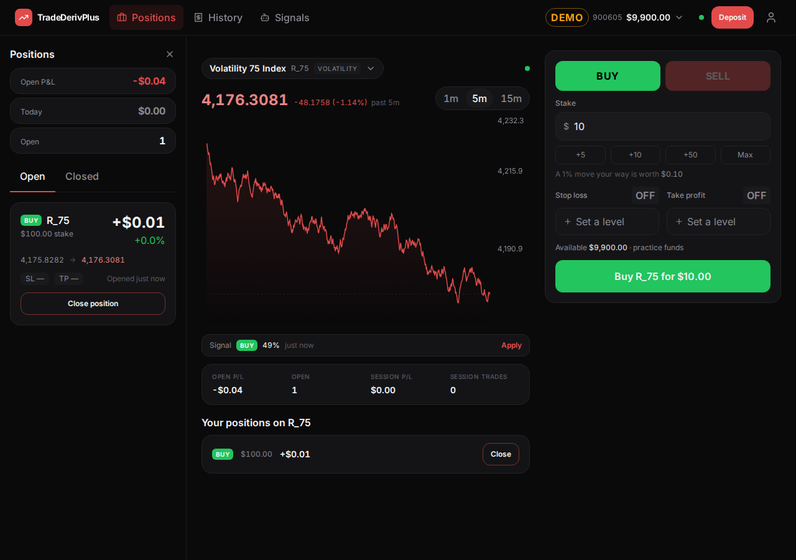
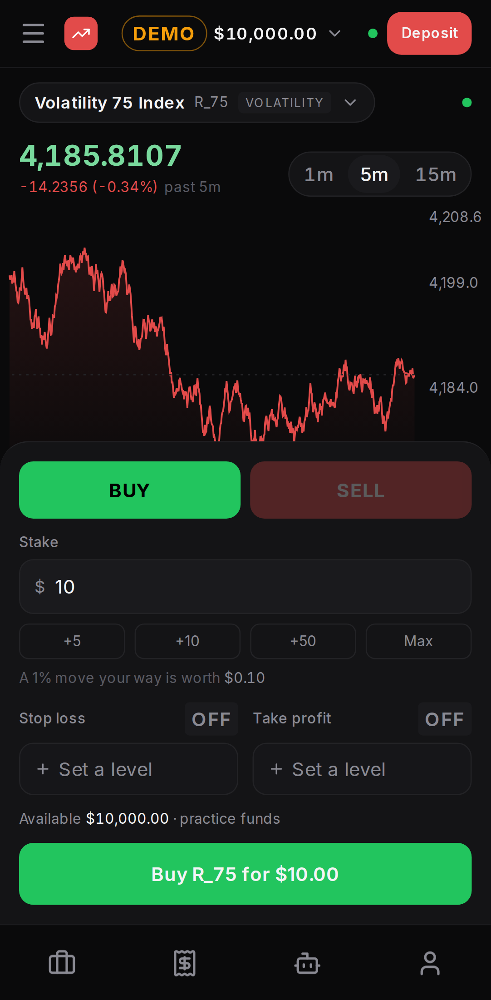
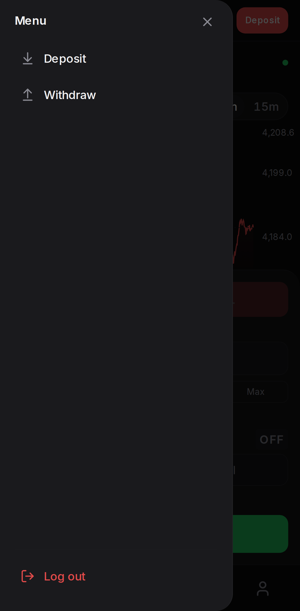
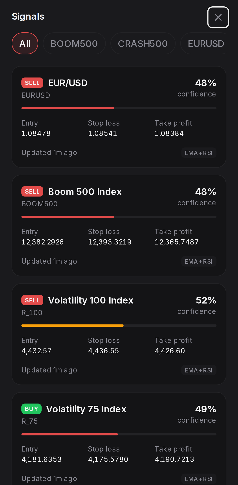

# One-Screen Migration — Phase 4 Implementation Report

**Scope:** Phase 4 of `docs/investigation-reports/one-screen-migration-plan.md`, with the revised bottom-bar decision. Phase 5 (cleanup) is not in this report.

**Commits:** `ee24f79` → `ceeae2b`, six in order: move the surface, delete Home, rebuild the bottom bar, shrink the drawer, rewrite the tests, fix the measurement script.

---

## 1. Summary

**The app is one screen now.** `/` is the trading surface — chart, ticket, session strip — and it is the only route that renders anything. Everything else is a panel over it or a sheet on top of it, and every URL that used to be a screen is a redirect that lands on the surface with its state intact.

**On a phone, the change is the bottom bar.** It used to be five destinations, and tapping one replaced the page you were on. It is now four icon-only toggles — Positions, History, Signals, Account — and tapping one slides that panel up over the chart. Tapping it again puts it away. Nothing navigates: the chart is always the thing underneath, and the trade you were setting up is where you left it. The hamburger still opens the drawer, but the drawer is down to the three things that are not panels: Deposit, Withdraw, Log out.

**On a desktop the change is smaller**, because the top bar already worked this way. It loses its Trade item — a link to the page you are on is not a destination — and the logo is the way back to a clean surface.

| The surface at 1280px, Positions open | The surface on a phone |
|---|---|
|  |  |

| The drawer, down to three | Signals as a sheet over the chart |
|---|---|
|  |  |

---

## 2. Per-step outcome

### Step 1 — Move the main surface to `/` ✅

`MAIN_SURFACE` is `/`. Because Phases 2 and 3 made everything read the surface's path from that constant rather than writing it, the move itself was one line; the work was in the redirect and the audit.

`/trade` is now `SurfaceRedirect`, a new sibling of `PanelRedirect` in `redirects.tsx`. It differs from `PanelRedirect` in one way that matters: it forwards the **whole** query string rather than a named list. `PanelRedirect` carries named parameters because the old screens' parameters had to be translated into panel terms; `/trade`'s parameters mean exactly the same thing at `/`, so translating them would only be a way to lose one. The five `signalHref()` emits (`symbol`, `direction`, `sl`, `tp`, `expired`) plus `panel` all cross untouched.

The redirect is permanent. Signal links, anything a user bookmarked, and the deposit flow's old destination all point at `/trade`.

### Step 2 — Delete Home ✅

Four files deleted: `HomeScreen.tsx`, `AccountStrip.tsx`, `OpenPositionsSummary.tsx`, `RecentActivity.tsx`. Every one of them was a preview of something that is now one tap away. `TransactionRow` (which `RecentActivity` wrapped) stays — the History panel renders it. `SignalCard` stays — the Signals panel renders it. Home's latest-signal block was the only other consumer and went with the file.

**Deviation: `BalanceCard` moved rather than staying put.** The prompt said to keep it, and it is kept, but leaving it in `features/home/` as the sole occupant of a directory named after a deleted screen, imported by `features/wallet/`, is a misleading place for it. It is now `features/wallet/BalanceCard.tsx`, one import line changed, and `features/home/` is gone entirely.

**One consequence handled here rather than left dangling:** `AppShell` capped `<main>` at 1200px for every route that was not the surface. With Home deleted there is no such route — the remaining ones render a `<Navigate>` and no content — so the conditional could never be true again. It is removed and `<main>` is simply full width. This is not the Phase 5 dead-code sweep; it is the direct consequence of the deletion in this step, and leaving a live-looking conditional that cannot fire would have been worse than removing it.

### Step 3 — Rebuild the bottom bar as panel toggles ✅

`TabBar` is now four `<button>`s, icon only, each with `aria-label` and `aria-pressed`, driven by `usePanel().toggle()` — the same mechanism and the same semantics the top bar has had since Phase 2. Active state comes from which panel is open, never from a route. No Home item, no Trade item.

**Deviation, and the one place I went beyond the step:** the top bar's Trade item is also gone. Phase 3's readiness list raised it as the first thing Phase 4 should resolve, and the reasoning that removes it from the bottom bar ("Trade is the background, not a destination") applies identically at desktop width. The logo, which already pointed at `MAIN_SURFACE`, is the way back to a clean surface, as the plan intended. The desktop row is now three toggles; Account remains the icon at the far right, beside the account pill, because it belongs with the identity controls rather than in the row.

**One thing consolidated while both bars were open:** each panel's label and icon were declared in three places — the top bar's row, the bottom bar's tabs, and `AppShell`'s panel titles — and they had already drifted (History was a clock on the desktop and a receipt on the phone). With the phone showing the icon alone, an icon that does not carry the label's meaning is a defect rather than a detail. They now come from one record, `features/shell/panelItems.ts`, which the two bars and each panel's own header all read.

### Step 4 — Shrink the drawer ✅

`NavDrawer` is Deposit, Withdraw and Log out. The four `Destination` entries went with the `Destination` component itself, and with them the `usePanel` and `react-router-dom` imports — nothing in the drawer navigates any more. Each item either raises one of the shell's sheets or ends the session.

It opens, closes and lays out correctly with three items; nothing assumed a count. The one visible consequence is that the drawer is mostly empty, because Log out is pinned to the foot by `mt-auto` — that was a deliberate choice when there were six items above it and it still reads correctly with two, as the screenshot in section 1 shows.

### Step 5 — Reconcile the two mobile panel-access paths ✅

Confirmed, and now asserted by a test rather than by inspection: the drawer contains no links at all (`menu.getByRole('link')` has count 0), and the bottom bar contains no links either — four buttons, all reporting `aria-pressed="false"` on a fresh surface. Each panel has exactly one control per breakpoint.

### Step 6 — Chart and ticket sizing ⚠️ Measured, not changed

Flagged rather than guessed, per the step's own instruction. Measured on a 412×915 phone with `e2e/measure.mjs`:

| | |
|---|---|
| Viewport | 915px |
| Document | 1088px |
| Top bar | 57px |
| Chart | 240px, ending at y=413 |
| Gap to the ticket | 33px (the session strip) |
| Bottom bar | 64px |

The surface overflows a phone screen by **173px**, which is one scroll gesture. Nothing this phase changed that number: Home was never part of this page's vertical budget, and the revised decision keeps the bottom bar, so `spacing.tabbar` and its four consumers are untouched as instructed.

Reclaiming the overflow would mean taking ~170px out of what sits below the chart — the session strip, or the ticket's stop-loss/take-profit row — not out of the chart, which at 240px is already the smallest a candle chart reads well at. That is a design judgement, so it is left for the client along with the other two in section 7.

One thing worth noting for Phase 5: `h-[240px] lg:h-[340px]` is written out in three files (`PriceChart.tsx`, `ChartSkeleton.tsx`, and `TradeScreen.tsx`'s empty state). Whoever changes it has to find all three. A spacing token would fix that, and Phase 5 is already touching the token file.

### Step 7 — Test rewrite ✅

- **`goTo()` is gone.** Its two remaining destinations were Home and Trade, and neither exists. Panels are opened by `openPanel()`, which now presses a toggle at both widths — scoped to the bar the viewport actually shows, because the other bar is in the DOM at every width, just hidden. The drawer branch it had for Account is gone with the drawer's panel entries.
- **`register()` asserts the landing itself.** It waits for the account pill in the top bar to read `demo` and `$10,000.00`, which is the assertion Home's balance card used to carry, moved to the one place that still shows a balance on arrival. Every spec inherits it, so the "signup lands on a funded demo account" check did not have to be rewritten per spec.
- **The trading spec stopped travelling to check a balance.** Two `goTo(page, 'Home')` round trips became `expect(accountPill(page)).toContainText('$9,900.00')` and a regex read of the same pill. The spec is now entirely about trading, which is what it is named for.
- **Redirect coverage is all five routes.** `/trade` with a full signal query string, asserted both on the URL that results and on the ticket reading `Sell R_100` from it; then `/portfolio`, `/wallet`, `/signals` and `/profile` each redirecting, opening their panel, closing it, and being reopened from the chrome. A sixth case covers the catch-all: `/home` lands on the surface.
- **New: the phone's chrome has its own test.** Four toggles in the bottom bar, no links in it, a panel opening and closing from it, and a drawer with the three actions and no links. This is the test that would fail if Step 4's removal were ever undone.

---

## 3. Files changed

**Deleted (4):**

- `src/features/home/HomeScreen.tsx`
- `src/features/home/AccountStrip.tsx`
- `src/features/home/OpenPositionsSummary.tsx`
- `src/features/home/RecentActivity.tsx`

**Moved (1):** `src/features/home/BalanceCard.tsx` → `src/features/wallet/BalanceCard.tsx` (contents unchanged)

**New (1):** `src/features/shell/panelItems.ts` — one record of label and icon per panel, read by both bars and by the panel header

**Changed (app, 9):**

| File | Change |
|---|---|
| `src/App.tsx` | `/` renders `TradeScreen`; `/trade` is `SurfaceRedirect`; Home's route and import gone |
| `src/features/shell/usePanel.ts` | `MAIN_SURFACE` is `/` |
| `src/features/shell/redirects.tsx` | Adds `SurfaceRedirect`, which forwards the whole query string |
| `src/features/shell/TabBar.tsx` | Rewritten: four icon-only panel toggles |
| `src/features/shell/TopBar.tsx` | Trade item removed; row reads `PANEL_ITEMS`; logo points at `MAIN_SURFACE` |
| `src/features/shell/NavDrawer.tsx` | Panel entries and the `Destination` component removed |
| `src/features/shell/AppShell.tsx` | Panel titles from `PANEL_ITEMS`; the 1200px cap on `<main>` removed |
| `src/features/wallet/DepositSheet.tsx` | Success step is one button that closes the sheet |
| `src/features/signals/SignalCard.tsx` | `signalHref()` builds on `MAIN_SURFACE` |
| `src/features/wallet/HistoryPanel.tsx` | `BalanceCard` import path |

**Changed (tests and scripts, 6):** `e2e/helpers.ts`, `e2e/user.panels.spec.ts`, `e2e/user.trading.spec.ts`, `e2e/user.deposit.spec.ts`, `e2e/admin.spec.ts`, `e2e/measure.mjs`, `e2e/shots.mjs`

Net: **318 insertions, 628 deletions.**

---

## 4. The `navigate('/trade')` audit

Everything in the repo that named the surface, and what happened to it. The blanket redirect would have caught the last three; they are listed because the instruction was to say what was checked.

| Where | What it was | Handling |
|---|---|---|
| `DepositSheet.tsx:270` | The success step's "Start trading" button, `onOpenChange(false)` then `navigate('/trade')` | **Closes the sheet only.** The chart is behind it, so there is nowhere to go. This left two buttons doing the same thing — "Start trading" and a ghost "Done" — so the success step is now one primary button, "Start trading". `useNavigate` is gone from the file |
| `SignalCard.tsx:31` | `signalHref()` building `/trade?...`, the app's one deep link | **Builds on `MAIN_SURFACE`.** It could have been left to the redirect, but every signal click would take an extra hop and land on a replaced history entry |
| `TabBar.tsx:28` | The Trade tab, `to: MAIN_SURFACE` | **Gone** with the bar's rebuild (Step 3) |
| `TopBar.tsx:41` | The Trade row item, `to: MAIN_SURFACE` | **Gone** (Step 3, deviation) |
| `TradeScreen.tsx:247` | `navigate(signalHref(latestSignal))` — the "Apply" action on the signal strip | **Unchanged in form**, and now correct by construction since `signalHref` builds on `MAIN_SURFACE`. It navigates to the page it is already on with new parameters, which is how the ticket gets prefilled |
| `App.tsx:59` | The `/trade` route | **Became the redirect** |
| `e2e/user.panels.spec.ts` ×3, `e2e/user.trading.spec.ts`, `e2e/admin.spec.ts` | `page.goto('/trade')` after registering or logging in | **Removed.** Registration and login now land on the surface, so the navigation was a no-op hop |
| `e2e/shots.mjs`, `e2e/measure.mjs`, `e2e/signal-pill-probe.mjs` | `/trade?panel=...` in the dev scripts | **Updated to `/`.** The probe is unchanged in behaviour; the redirect would have worked, but a script that measures the surface should ask for it directly |

**Not found anywhere:** a `navigate('/trade')` in a hook, a store, or an API error path. `useAuth` sends a logged-out user to `/login`, and `LoginScreen`/`RegisterScreen` send a signed-in one to `/` — which is the surface now, and was already written as `/` rather than as a screen name, so neither needed changing.

---

## 5. Discovered mid-implementation

**1. The two bars had drifted on what History looks like.** The top bar drew a clock, the bottom bar drew a receipt, and `AppShell` spelled the titles out a third time. Invisible while the phone showed text labels under its icons; a defect the moment the label goes away, which is what Step 3 does. Hence `panelItems.ts`. This is the consolidation Phase 3's report predicted would be needed when the chrome got its final shape.

**2. A panel on a phone takes the bottom bar out of the accessibility tree.** The mobile panel is a modal sheet covering the viewport, so while one is open, Radix marks everything behind it `aria-hidden` — including the bar that opened it. Two consequences:

- **For users:** you cannot switch directly from one panel to another on a phone. Close, then open the next. That is ordinary modal behaviour and the panels are full-screen, so there is nothing to switch *to* visually, but it does mean the bar's `aria-pressed="true"` state is essentially never seen at that width. Everything is `false` whenever the bar is visible. Left as is — the alternatives are a non-modal sheet (which would undo the focus containment verified in Phases 2 and 3) or rendering the bar inside the sheet, and neither is a small change. Flagged for the client rather than decided here.
- **For tooling:** the screenshot script silently wrote no drawer image, because `getByRole('button', { name: 'Open menu' })` found nothing while a panel was open. It now returns to the bare surface first.

**3. The `/trade` redirect needed a different shape from `PanelRedirect`.** Covered in Step 1. Worth restating because it is the only redirect in the app that forwards everything: the others forward a named list on purpose.

**4. The deposit spec's demo-user test lost its entry point.** It clicked "Top up demo" on Home's balance card. The card is in the History panel now, so the test opens that panel first — which is the more honest version of the test anyway, since that is where a demo user now finds the button. Note this is the second time this spec has moved for this reason: Phase 3 moved it *to* Home from Wallet.

**5. The pill's text is not only a balance.** `accountPill().innerText()` returns the account type, the account number on a desktop, and the balance. The trading spec reads the figure with a `$([\d,]+\.\d{2})` match rather than stripping non-digits, which would have concatenated the account number onto it.

---

## 6. Verification performed

`npm run typecheck`, `npm test` and `npm run build` after every commit, clean throughout.

| | Result |
|---|---|
| Typecheck | Clean |
| Unit tests | 74 passed |
| Build | Clean |
| Lint | 21 warnings — unchanged from the Phase 2 baseline. No new ones |
| Playwright `desktop` | **14 passed, 1 skipped** |
| Playwright `mobile` | **10 passed, 1 skipped** |

The skips are the pre-existing admin KYC spec (desktop) and the two breakpoint-specific tests, each of which skips itself at the width it does not apply to: "closing History leaves Positions where it was" is desktop-only, "the bottom bar carries the panels" is phone-only.

**Five-route redirect coverage, explicitly** — `user.panels.spec.ts`, "all land on the surface with what they were carrying", run at both breakpoints:

| Route | Lands on | State preserved | Asserted |
|---|---|---|---|
| `/trade?symbol=R_100&direction=sell&sl=1.5&tp=2.5&expired=1` | `/?symbol=R_100&...` | All five parameters | URL parameters read individually, **and** the ticket showing `Sell R_100 for …` — so the surface consumed them, not just kept them |
| `/portfolio` | `/?panel=positions` | — | Panel visible, closes, reopens from the chrome |
| `/portfolio?tab=closed` | `/?panel=positions&tab=closed` | `tab` | Separate test: the Closed tab is the active one on arrival |
| `/wallet` | `/?panel=history` | — | Panel visible, closes, reopens from the chrome |
| `/signals` | `/?panel=signals` | — | Panel visible, closes, reopens from the chrome |
| `/profile` | `/?panel=account` | — | Panel visible, closes, reopens from the chrome |
| `/home` (anything unknown) | `/` | — | Surface renders: the ticket is there |

**Checked by hand from the screenshots in section 1:** the top bar without its Trade item at 1280px and 1920px, the four-icon bottom bar at 393px and 360px (icons stay comfortably apart at the narrow width — there are four now, where five labelled tabs previously fit), the drawer's three items, and each panel opening over the surface at both widths.

---

## 7. State of the migration

**This closes out the migration's structural work.** The app has one route that renders, four panels over it, and six redirects. Phase 5 is cleanup only — nothing in it changes behaviour.

**What Phase 5 has waiting:**

- **Delete `PageHeader`** — zero consumers since Phase 3, confirmed still zero.
- **The unused `section` spacing token**, plus a **chart-height token** to replace the `h-[240px] lg:h-[340px]` literal written out in three files (section 2, Step 6).
- **`usePanel().href`** is now unused by any component — the drawer was its last consumer. The function stays because `open()` uses it internally; it is the export that can go.
- A general dead-code sweep now that four components and a screen are gone.

**Still outstanding from earlier phases, re-raised so it survives into the last report:**

- **The deployed feed has still not been verified.** Every price and signal check in Phases 0–4 ran against the local mock (`USE_MOCK_FEED=true`). The shell-owned socket, its reference counting, and the panel-under-load behaviour are proven against the mock only. Phase 3 recommended doing this before Phase 4; it did not happen, and it is now the oldest open item in the migration. It is also the one that cannot be checked by reading code.
- **The 1280px chart width.** At 1280 with a panel open the chart is **528px** wide; with no panel, 828px. At 1920 it is 1168px with a panel. Whether 528px is an acceptable floor — or whether the panel should collapse below some width — is a client judgement, unchanged since Phase 2 and unchanged by this phase.
- **The ultrawide aspect ratio.** At 2560px the chart is 1808px wide and still 340px tall. Also unchanged, also a judgement call.
- **The phone's 173px of vertical overflow** (section 2, Step 6) joins these three as a measured-but-not-decided layout question.
